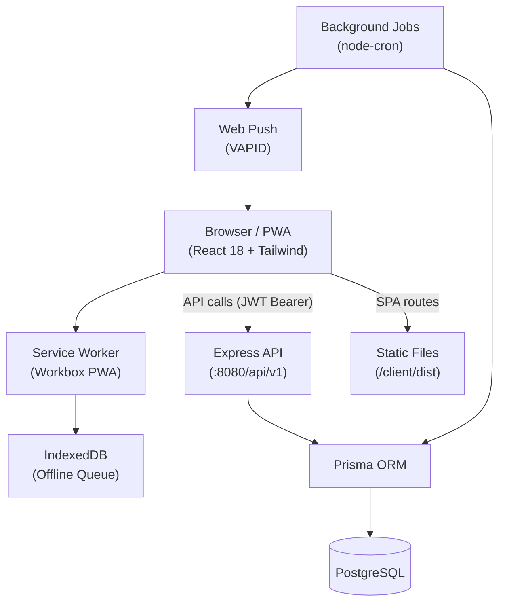

# 💊 CareCompanion – Elderly Care & Medication Management Platform

> **Hackathon Project** · Full-stack · Single Docker container · Production-ready

A polished, secure, and accessible web application helping elderly people take the right medicine at the right time, track their health, and stay connected with family caregivers.

---

## ⚕️ Medical Disclaimer

> **CareCompanion does not replace professional medical advice, diagnosis, or treatment.**
> Always consult your doctor, pharmacist, or qualified healthcare provider for all medical decisions.
> Never ignore professional medical advice because of something in this app.

---

## 🚀 Quick Start (Docker)

```bash
# 1. Clone the repository
git clone https://github.com/your-username/carecompanion.git
cd carecompanion

# 2. Start with Docker Compose
docker compose up --build

# App available at: http://localhost:8080
# API docs at:      http://localhost:8080/api/docs
```

Demo accounts are auto-seeded on first start:
| Role | Email | Password |
|------|-------|----------|
| Senior (Kamala Devi, 72) | `demo.senior@carecompanion.app` | `Demo@1234` |
| Caregiver (Priya, daughter) | `demo.caregiver@carecompanion.app` | `Demo@1234` |

---

## 🛠️ Local Development Setup

### Prerequisites
- Node.js 20+
- PostgreSQL 16+

```bash
# Install dependencies
npm install

# Copy env file and configure
cp .env.example .env
# Edit .env with your database URL and secrets

# Generate Prisma client
npm run generate --workspace=server

# Run database migrations
npm run db:migrate --workspace=server

# Seed demo data
npm run seed --workspace=server

# Start dev servers (both client and server in parallel)
npm run dev
```

- Client: `http://localhost:5173` (Vite dev server with HMR)
- Server: `http://localhost:8080` (with API proxy from client)
- API Docs: `http://localhost:8080/api/docs`

---

## 🔐 Environment Variables

Copy `.env.example` to `.env` and configure:

| Variable | Description | Required |
|----------|-------------|----------|
| `DATABASE_URL` | PostgreSQL connection string | ✅ |
| `JWT_ACCESS_SECRET` | Min 32 chars, random | ✅ |
| `JWT_REFRESH_SECRET` | Min 32 chars, random | ✅ |
| `VAPID_PUBLIC_KEY` | For Web Push notifications | ⬜ |
| `VAPID_PRIVATE_KEY` | For Web Push notifications | ⬜ |
| `VAPID_SUBJECT` | mailto: for VAPID | ⬜ |
| `SMTP_HOST` | SMTP server for emails | ⬜ |
| `SMTP_USER` / `SMTP_PASS` | SMTP credentials | ⬜ |
| `SEED_ON_START` | Set to `"true"` to auto-seed | ⬜ |

### Generate VAPID Keys (for Web Push)
```bash
npx web-push generate-vapid-keys
# Copy output to VAPID_PUBLIC_KEY and VAPID_PRIVATE_KEY in .env
```

### Generate JWT Secrets
```bash
node -e "console.log(require('crypto').randomBytes(64).toString('hex'))"
# Run twice – once for ACCESS, once for REFRESH
```

---

## 🏗️ Architecture



**One container, one origin** – in production, Express serves both the React build AND the API, eliminating CORS issues and simplifying deployment.

---

## 📁 Project Structure

```
carecompanion/
├── package.json              # Workspace root
├── Dockerfile                # Multi-stage build
├── docker-compose.yml        # App + Postgres
├── render.yaml               # Render.com blueprint
├── .env.example              # Environment template
│
├── client/                   # React frontend
│   ├── src/
│   │   ├── pages/            # Senior + Caregiver pages
│   │   ├── layouts/          # SeniorLayout, CaregiverLayout
│   │   ├── components/       # Reusable UI components
│   │   ├── hooks/            # useAuth, useSettings
│   │   ├── services/         # API client
│   │   ├── i18n/             # English, Hindi, Kannada
│   │   ├── offline/          # IndexedDB offline queue
│   │   └── styles/           # Tailwind global styles
│   └── vite.config.ts
│
└── server/
    ├── prisma/
    │   ├── schema.prisma     # 15+ models
    │   └── seed.ts           # Demo data seeder
    └── src/
        ├── config/           # env, database, logger
        ├── routes/           # Express routers
        ├── controllers/      # Request handlers
        ├── middleware/        # auth, errorHandler, rateLimiter
        ├── services/         # pushService
        ├── jobs/             # node-cron background jobs
        ├── data/             # interactions.json, foodWarnings.json
        └── tests/            # Vitest + Supertest
```

---

## 🔌 API Overview

Base URL: `/api/v1` · Full docs: `/api/docs` (Swagger UI)

| Group | Endpoints |
|-------|-----------|
| **Auth** | `POST /auth/register`, `POST /auth/login`, `POST /auth/refresh`, `POST /auth/logout`, `GET /auth/me` |
| **Care Links** | `POST /care-links/invite`, `POST /care-links/redeem`, `GET /care-links`, `DELETE /care-links/:id` |
| **Medications** | Full CRUD + `GET /medications/:id/doses` |
| **Doses** | `GET /doses/today`, `POST /doses/:id/take\|skip\|snooze` |
| **Vitals** | Full CRUD + `GET /vitals/trends` |
| **Check-in** | `POST /checkin`, `GET /checkin/today` |
| **Appointments** | Full CRUD |
| **Side Effects** | Full CRUD |
| **Emergency** | `GET /emergency/medical-id` |
| **Reports** | `GET /reports/doctor-summary` |
| **Caregiver** | `GET /caregiver/seniors`, `GET /caregiver/seniors/:id/dashboard` |
| **Interactions** | `GET /interactions/check?medicines=a,b,c` |
| **Games** | `GET /games/scores`, `POST /games/scores` |
| **Push** | `GET /push/vapid-public-key`, `POST /push/subscribe\|unsubscribe` |
| **Account** | `GET /account/export`, `DELETE /account` |
| **Health** | `GET /health`, `GET /health/ready` |

---

## 🔒 Security Decisions

| Decision | Rationale |
|----------|-----------|
| **Argon2id** password hashing | OWASP-recommended, memory-hard, resistant to GPU attacks |
| **Short-lived JWT (15m) + rotating refresh tokens** | Limits blast radius of token theft; refresh tokens hashed in DB |
| **httpOnly + Secure + SameSite=Strict cookies** | Prevents XSS-based token theft; CSRF mitigated by SameSite |
| **Helmet.js** | Sets ~15 security headers (CSP, HSTS, X-Frame-Options, etc.) |
| **express-rate-limit** | 10 req/15min on auth endpoints to prevent brute force |
| **Zod validation** on every endpoint | Prevents injection, ensures type safety at runtime |
| **IDOR prevention** | Every caregiver endpoint checks `CareLink` before returning data |
| **Invite code system** | Seniors must approve each caregiver link; codes expire in 24h |
| **Audit log** | Tracks login, linking, exports, deletions for security auditing |
| **No stack traces in production** | Error handler strips stack traces; only sanitized messages sent |

---

## 🌐 Deployment

### Render + Neon (Recommended)

1. **Create Neon database**: https://console.neon.tech
   - Create project → Copy connection string
   
2. **Deploy to Render**:
   ```bash
   # Using render.yaml blueprint
   # Push to GitHub, then connect in Render dashboard
   # Set environment variables in Render's secret management:
   # - DATABASE_URL (from Neon)
   # - VAPID_PUBLIC_KEY + VAPID_PRIVATE_KEY (run npx web-push generate-vapid-keys)
   ```

3. **Or using Render CLI**:
   ```bash
   render blueprint apply
   ```

### Manual Docker Deploy

```bash
# Build and tag
docker build -t carecompanion:latest .

# Run with env vars
docker run -p 8080:8080 \
  -e DATABASE_URL="postgresql://..." \
  -e JWT_ACCESS_SECRET="..." \
  -e JWT_REFRESH_SECRET="..." \
  -e VAPID_PUBLIC_KEY="..." \
  -e VAPID_PRIVATE_KEY="..." \
  -e SEED_ON_START="true" \
  carecompanion:latest
```

---

## ✅ Running Tests

```bash
# All tests
npm run test

# Watch mode
npm run test:watch --workspace=server
```

Tests cover:
- Auth registration, login, duplicate email rejection
- Token validation and refresh
- Authorization: caregiver cannot access unlinked senior (IDOR prevention)
- Dose taking with stock decrement
- Interaction checker with real data
- Health endpoint

---

## 🏗️ Building for Production

```bash
npm run build
# client → client/dist (static SPA)
# server → server/dist (compiled TS)
```

---

## 🧪 Demo Data

The seed script creates a realistic demo:
- **Kamala Devi, 72** – Type 2 Diabetes, Hypertension, mild Arthritis
- **6 medications**: Metformin 500mg (3×/day), Amlodipine 5mg, Atorvastatin 10mg, Aspirin 75mg, Pantoprazole 40mg, Vitamin D3 60000 IU
- **30 days of dose history** at ~82% adherence
- **Daily vitals** (BP, sugar, weight, sleep, mood, pain)
- **3 appointments** (past + upcoming)
- **2 side effects** (one resolved, one active)
- Linked to **Priya Devi** (caregiver/daughter)

Re-seed anytime:
```bash
npm run seed --workspace=server
```

---

## 📱 PWA Features

- Installable on Android and iOS
- Offline-first dose taking (queued in IndexedDB)
- Offline check-in queuing
- Service worker with Workbox (auto-update)
- Web App Manifest with icons

---

## ♿ Accessibility

- **WCAG AA** color contrast ratios
- **56px minimum** touch targets on all interactive elements
- **18px minimum** base font size with text size slider (100%-200%)
- Full **keyboard navigation** with visible focus rings
- **ARIA labels** on all icons and interactive elements
- **Role-based headings** and semantic HTML
- **Screen reader** compatible
- **Reduce motion** mode respects `prefers-reduced-motion`
- **High contrast** mode
- **Voice read-aloud** on medication cards (Web Speech API)
- **Bottom navigation** with both icons AND text labels

---

## 🌍 Internationalization

UI available in 3 languages:
- 🇺🇸 **English** (default)
- 🇮🇳 **Hindi** (हिंदी)
- 🇮🇳 **Kannada** (ಕನ್ನಡ)

Language is saved in user profile and localStorage.

---

## 📄 License

MIT License – see [LICENSE](LICENSE)

---

*Built with ❤️ for elderly care. This project is not affiliated with any medical institution.*
